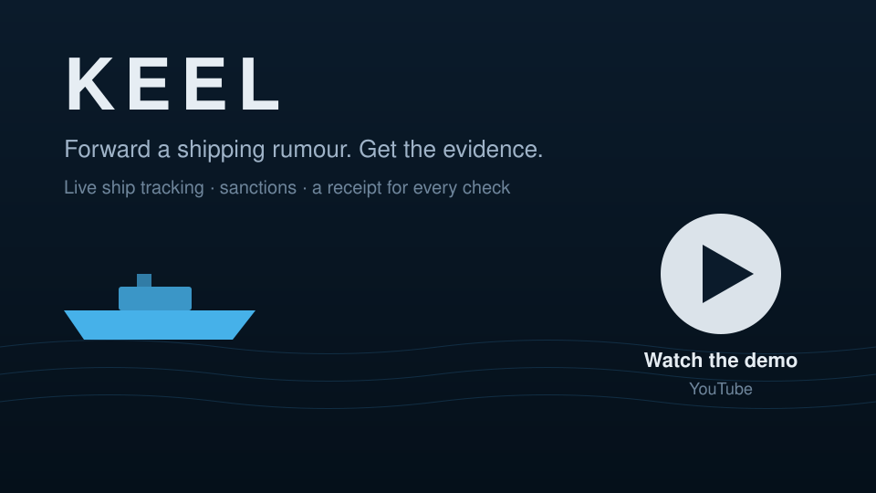
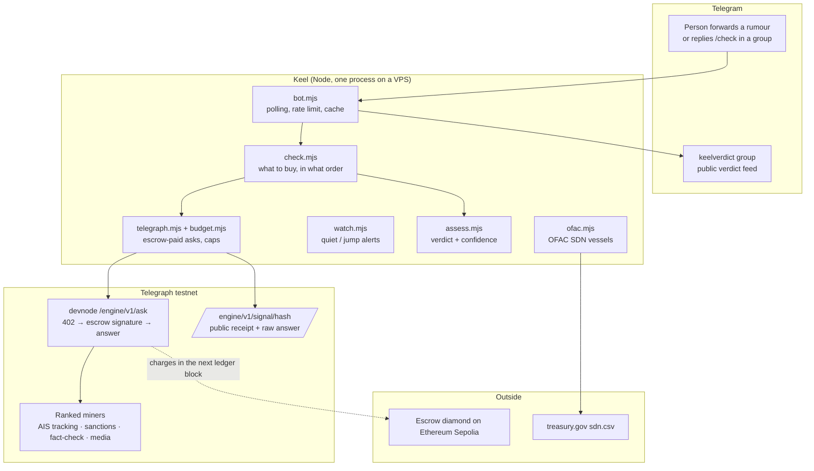
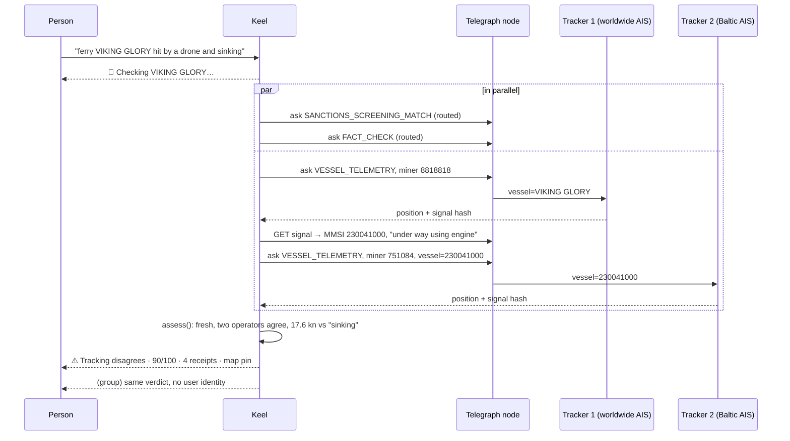

<div align="center">

# KEEL

### Forward a war or shipping rumour to a Telegram bot. It checks it against live ship tracking it buys on Telegraph, and shows you a receipt for every check.

[](https://github.com/subheeksh5599/keel/actions/workflows/test.yml)

[](https://t.me/keel567_bot)
[](#verify-every-claim-in-one-command)

[](LICENSE)


**[ ▶ Demo video ↗ ](https://youtu.be/2_0ge0ViQG0)** · **[ Try the bot ↗ ](https://t.me/keel567_bot)** · **[ Receipts dashboard ↗ ](https://subheeksh5599.github.io/keel/)** · **[ For judges ↓ ](#for-judges-try-it-in-two-minutes)** · **[ Verify every receipt ↓ ](#verify-every-claim-in-one-command)** · **[ The rules ↓ ](#what-the-verdict-measures)** · **[ Status table ↓ ](#whats-real--the-status-table)**

<br><br>

<a href="https://youtu.be/2_0ge0ViQG0"></a>

<sub>▶ The demo: a "sinking" ferry that is making way, a public receipt, a sanctioned tanker nobody can hear, and a check in a group.</sub>

</div>

"Tanker hit and sinking in Hormuz." A post like that moves oil prices within minutes, and a lot of them are wrong. Keel is a Telegram bot you forward the rumour to. It pulls the ship out of the message, **buys the ship's live position from two tracking miners run by different operators**, screens it against sanctions lists (a Telegraph screening miner **and** OFAC's own list, read directly), fact-checks the claim, and replies with a verdict, a 0-100 confidence with its reasons, a map pin, and **the price and a public receipt for every answer it bought**. Every purchase is paid from an escrow balance on the Telegraph testnet. Every receipt is a signal anyone can open, and the node confirms it with a keccak256 commitment.

```
A POSITION REPORT ≠ PROOF        ONE SOURCE ≠ AGREEMENT        A FAILED CHECK ≠ A CLEAN BILL
```

Keel never calls a rumour false on tracking alone. A ship that is moored can still be damaged, and a transmitter can be spoofed. What it does say, with evidence: *the ship is 4,632 km from where the rumour puts it*, *it is making 17.6 knots, which a sinking ship would not*, *it was transmitting a minute ago, so it has not gone dark*, *it is on a sanctions list*.

## Live status

| Surface | Status | The evidence |
|---|---|---|
| Demo video | About 2 minutes, recorded in Telegram | [youtu.be/2_0ge0ViQG0](https://youtu.be/2_0ge0ViQG0) |
| Telegram bot [@keel567_bot](https://t.me/keel567_bot) | Live, 24/7 on a VPS under pm2 | Forward it a rumour; `/stats` shows what it has checked |
| Paid Telegraph asks | Live on the testnet, escrow-paid | Payer `0x2925d43C1e21888706D8b3b2223050aF14dDAEd4`; 15 test USDC [deposited](https://sepolia.etherscan.io/tx/0xa4b2e4387444d58ed2ce9dff038fe4629d12cc37908b8e888072b69f0595290e) on Ethereum Sepolia |
| Evidence run | 6 rumours, 22 paid answers | [`receipts/evidence-2026-11-27T10-03-55-961Z.json`](receipts/evidence-2026-11-27T10-03-55-961Z.json) |
| Pre-registered run | 8 new rumours, expected verdicts [committed first](evidence/preregistered-2026-11-27.json) (commit `0db8c3c`), then run live: **8 of 8 matched** | [`receipts/preregistered-2026-11-27T16-12-37-714Z.json`](receipts/preregistered-2026-11-27T16-12-37-714Z.json) |
| Checks through Telegram | 5 on 28 Nov (private chat and the group), each saved as a receipt with no chat id | [`receipts/telegram/`](receipts/telegram/) |
| Watches | 19 polls on 3 ships in the first 18 hours, $0.20 in all; one alert (sanctioned EAGLE S gone quiet), and VIKING GLORY found on every poll | [`receipts/telegram/watch-log.jsonl`](receipts/telegram/watch-log.jsonl), pulled by `scripts/pull-receipts.sh` |
| Receipt check | 100 / 100 signals verified on the node | `node scripts/verify-receipts.mjs`, output [below](#verify-every-claim-in-one-command) |
| Public verdict group | Bot posts each verdict (no user identity) | [keelverdict](https://t.me/+Kzl7YJUEUedhZmY1) |
| Receipts dashboard | Every saved check, each answer linked to its signal | [subheeksh5599.github.io/keel](https://subheeksh5599.github.io/keel/), built by `scripts/dashboard.mjs` |
| Tutorial | Buy one live ship position in about 40 lines | [`docs/TUTORIAL.md`](docs/TUTORIAL.md), [`examples/buy-position.mjs`](examples/buy-position.mjs) |
| Progress updates | Public, in the mission thread | [27 Nov](https://github.com/telegraphprotocol/bounties/issues/193#issuecomment-7223086012) · [28 Nov](https://github.com/telegraphprotocol/bounties/issues/193#issuecomment-7238343146) |
| Tests | 68 passing, no network needed | `npm test`, and CI on every push |

## For judges: try it in two minutes

**Nothing to install:**

1. Open [@keel567_bot](https://t.me/keel567_bot) and press **Start**.
2. Paste: `BREAKING: ferry VIKING GLORY hit by a drone and sinking in the Baltic`
3. You get `🔎 Checking VIKING GLORY…` at once, then the reply turns into `⚠️ Tracking disagrees with the rumour` with two positions from two operators, the speed, the reasons, a map pin, and four `receipt` links. Tap one: it opens the signal on the Telegraph node, showing the payer wallet above, the miner, the request and the miner's raw answer.
4. Try one it cannot settle: `Sanctioned tanker ADRIAN DARYA 1 seized by IRGC in the Strait of Hormuz` gives `❓ Can't verify from tracking` (no receiver has heard it) plus `🚩 Sanctions:` from both sources.
5. Break it: send `good morning` (it buys nothing and explains what it needs), or send the same rumour twice within 10 minutes (the second answer is reused and says *nothing paid again*).
6. Press **👁 Watch this ship** under any verdict: it will message you if the ship goes quiet for 3+ hours.
7. In a group: add the bot, then reply to any message with `/check`, or forward a rumour into the group (forwards that name a ship and a claim are checked automatically).

**From a clone (10 minutes):** see [Run it yourself](#run-it-yourself). The full checklist, with what you should see at each step, is in [JUDGES.md](JUDGES.md).

## The 20-second pitch

Conflict news at sea arrives as unsourced posts: "struck", "sinking", "seized", "went dark". The checks that settle them already exist: where the ship actually is, whether it is moving, whether it is a sanctioned shadow-fleet tanker. But they sit in paid ship-tracking tools priced per seat, which is why nobody runs them on a rumour in a group chat.

Keel buys exactly the checks one rumour needs, for a few cents, from ranked miners on Telegraph, and shows what each one cost and what it said. **A rumour checked in about 15 seconds for $0.01 to $0.05, with every input on the record.**

## Table of contents

- [Live status](#live-status)
- [For judges: try it in two minutes](#for-judges-try-it-in-two-minutes)
- [See it in one command](#-see-it-in-one-command)
- [Verify every claim in one command](#verify-every-claim-in-one-command)
- [What Keel is NOT](#what-keel-is-not)
- [The problem I set out to solve](#the-problem-i-set-out-to-solve)
- [What I built](#what-i-built)
- [Architecture](#architecture)
- [The check, step by step](#the-check-step-by-step)
- [Where the rules are enforced](#where-the-rules-are-enforced)
- [What the verdict measures](#what-the-verdict-measures)
- [Who pays, and what it costs](#who-pays-and-what-it-costs)
- [Measured so far](#measured-so-far)
- [Engineering decisions & the traps that taught me something](#engineering-decisions--the-traps-that-taught-me-something)
- [What's real — the status table](#whats-real--the-status-table)
- [Attack → test](#attack--test)
- [Limitations](#limitations)
- [Security](#security)
- [Tech stack](#tech-stack)
- [Project layout](#project-layout)
- [Run it yourself](#run-it-yourself)
- [Full command reference](#full-command-reference)
- [How I deploy it](#how-i-deploy-it)
- [Results and supporting records](#results-and-supporting-records)
- [Tests](#tests)
- [Credits](#credits)
- [License](#license)

## ▶ See it in one command

The same check the bot runs, from the command line, against the live testnet (it spends about $0.04 of test USDC from your escrow):

```
$ node --env-file=.env scripts/check.mjs "BREAKING: ferry VIKING GLORY hit by a drone and sinking in the Baltic"
⚠️ Tracking disagrees with the rumour
🚢 VIKING GLORY (IMO 9827877 · MMSI 230041000) · rumour: sinking, struck or attacked
📍 60.123°N, 20.569°E · Baltic Sea · 17.6 kn, course 244° · "under way using engine" · under a minute ago · bound for FITKU&lt;&gt;FIMHQ/FILAN&lt;&gt;

Confidence 90/100
＋ Position reported under a minute ago.
＋ VesselWire and Quay (different operators) agree on where it is (21.1 km apart, consistent with the time between reports).
＋ It is reporting 17.6 kn, making way normally, which a sinking ship would not. A transmitter can keep sending after damage, so this is not proof.
· A fact-check miner found no reliable source either way ("Unverified").

Checks bought on Telegraph ($0.04 test USDC)
✓ Fact-check: Unverified · TelegraphIntent · $0.01 receipt 1
✓ Position (Quay): 60.082, 20.940, 20.8 kn · Quay · $0.01 receipt 2
✓ Sanctions screen: no match · Counterproof Sanctions Screener · $0.01 receipt 3
✓ Position (VesselWire): 60.123, 20.569, 17.6 kn · VesselWire Verbatim AIS Reports · $0.01 receipt 4
✓ OFAC SDN list (read directly from treasury.gov, free): no listing
Daily budget left: $1.53 · Testnet, test USDC

saved receipts/check-2026-11-27T10-06-09-928Z.json
```

The two positions are 21 km apart because one report is 40 minutes older than the other. Keel checks that the gap fits the reported speed (it needs about 17 knots, and the ship reports 17.6 to 20.8) before it counts the two sources as agreeing. (The `&lt;&gt;` in the destination is the HTML escaping the bot sends to Telegram; the ship broadcasts `FITKU<>FIMHQ/FILAN<>`.)

## Verify every claim in one command

No key and no wallet. The script opens every signal saved under `receipts/` (including the checks people ran through Telegram and every watch poll, once pulled from the server) on the Telegraph node and checks three things: the payer is Keel's wallet, the intent is the one bought, and the node's keccak256 commitment check passes.

```
$ node scripts/verify-receipts.mjs
signals 100 · verified 100 · not found 0 · mismatched 0 · paid by 0x2925d43c1e21888706d8b3b2223050af14ddaed4 · $1.00 test USDC across 11 file(s)
```

## What Keel is NOT

- **Not a fact-checker that rules on truth.** It reports what tracking, sanctions lists and fact-check miners say, side by side, and keeps disagreements visible instead of averaging them. The strongest thing it says is "tracking disagrees".
- **Not damage detection.** Position, speed, course and the ship's own navigational status cannot show a hole in a hull. Keel says so in the reply whenever a rumour claims an attack, fire or sinking.
- **Not satellite imagery.** It does not claim to see dark ships. When no receiver hears a ship it says exactly that, and that coastal receivers miss ships far offshore.
- **Not a conversational chatbot.** You forward or paste a rumour, or use `/check`; it answers with one structured verdict.
- **Not real money.** Every answer is paid in test USDC on the Telegraph testnet.

## The problem I set out to solve

During a crisis at sea, a claim about a named ship spreads faster than anyone checks it. The facts that would test it are mostly public: ships broadcast their own position, speed, course and status over AIS, and governments publish sanctions lists. Turning them into an answer still takes a paid tracking account, a sanctions lookup and someone's time. So in a group chat the check never happens, and the rumour wins.

What a checker has to get right is mostly about restraint. A moored ship can be damaged. A ship can broadcast a false position. One tracking source can confuse two ships with the same name. A sanctions lookup can fail, and a failed lookup is not a clean result. Keel is built around those cases.

## What I built

- **A rumour parser** that pulls ship names (after `tanker`, `MV`, `LNG carrier`…, in quotes, or in capitals), IMO numbers (check digit validated), MMSI numbers, the claim (struck, sinking, fire, seized, aground, gone dark, diverted, blocked), places (Hormuz, Bab el-Mandeb, Gulf of Finland…) and media links. `src/extract.mjs`
- **A Telegraph client** that asks a named miner or lets the node route, answers the node's HTTP 402 with an escrow signature, and records the signal hash, the miner and the price. A failed delivery is never billed and comes back off the spending count. `src/telegraph.mjs`
- **Spending limits enforced in code before anything is signed**: $0.30 per check and $2 per UTC day, kept on disk so a restart cannot reset them. `src/budget.mjs`
- **Two tracking sources from different operators**, read by miner id. One listens to terrestrial AIS receivers worldwide. The other relays Finland's official AIS feed and finds ships by MMSI, so it is asked only when the ship is in the Baltic and an MMSI is known (from the rumour or the first source). If the first tracker errors out, one more ask is routed by the node to whichever miner ranks best; when it answers "not heard in 14 days", Keel does not pay to ask again. `src/check.mjs`
- **The free public signal behind each receipt**, read after every tracking purchase. It carries the miner's full answer: IMO, MMSI, the status the ship itself broadcasts ("moored", "aground", "not under command"), its destination, and how many other ships share its name. `src/telegraph.mjs`, `src/check.mjs`
- **A second, independent sanctions source**: OFAC's own SDN list (1,570 vessels), downloaded from treasury.gov and refreshed once a day, and matched on the IMO or MMSI the tracker reported, or the exact name or a former name. `src/ofac.mjs`
- **A verdict engine** that is a pure function of the evidence, with a test for every rule. `src/assess.mjs`
- **The Telegram bot**: forwards and pasted rumours in private chats, `/check` in groups, a map pin with each verdict, a **Watch this ship** button, `/watch`, `/receipts`, `/stats`, a public verdict group, rate limits, and a 10-minute cache so the same rumour is never paid for twice. `src/bot.mjs`, `src/watch.mjs`, `src/format.mjs`, `src/store.mjs`
- **Receipts for everything the live bot buys**: each Telegram check is saved as a receipt file (the rumour, every purchase and signal hash, no chat id), and every watch poll is logged with what it bought and what it alerted. `scripts/pull-receipts.sh` copies them from the server, re-verifies them and rebuilds the dashboard.
- **A low-balance warning**: the bot reads its escrow balance every hour and warns once a day when it drops under $3, so it never stops quietly.
- **Evidence tooling**: a fixed set of six rumours that each exercise one rule, a pre-registered set whose expected verdicts were committed before the run (`scripts/evidence.mjs`), and a keyless verifier for every saved receipt (`scripts/verify-receipts.mjs`).

## Architecture



The bot sends one HTTP request per answer to the node and gets back a 402 with an escrow challenge. It signs the challenge with the payer key (the signature proves intent and cannot move funds), and the node bills the escrow only when the answer is delivered. The only other network calls are the free signal reads and the daily OFAC download.



| Bot command | What it does | Paid? |
|---|---|---|
| forward / paste (private chat) | Full check of the rumour | Yes, $0.01 per answer, capped at $0.30 |
| `/check` (reply, or with text) | Full check, in any chat | Same |
| `/watch NAME` or `/watch IMO 1234567` | Position every 2 h; alerts on quiet 3 h+, back on air, impossible jump, new sea area | $0.01 to $0.02 per poll |
| `/unwatch`, `/watches` | Manage watches (2 per chat, 10 in total) | No |
| `/receipts` | This chat's last five checks with receipt links | No |
| `/stats` | Totals across all chats | No |
| `/help`, `/about` | How it works, method and source | No |

## The check, step by step

1. **Parse.** `extract()` finds the ship, its IMO or MMSI, what is claimed and where. No ship and no claim means nothing is bought.
2. **Start the side checks.** The sanctions screen and the fact-check go to the node at once, routed to the best-ranked miner for each.
3. **First tracker.** Ask miner 8818818 by id. Then read the free signal for the IMO, MMSI, navigational status, destination and same-name count.
4. **Second tracker, only where it can see.** Miner 751084 covers the Baltic and finds ships by MMSI. It is asked with the MMSI from step 3 when the first position is in the Baltic, or when there is no position yet but an MMSI is known. Otherwise it is skipped, and the reply says why.
5. **Fallback.** If the pinned trackers failed without a definite answer, one more ask is routed by the node. A definite "not heard in 14 days" is not asked again.
6. **OFAC.** Match the local copy of OFAC's list on the IMO or MMSI (including ones a tracker reported) or the exact name or a former name.
7. **Assess.** `assess()` turns the evidence into a verdict, a confidence, reasons and flags.
8. **Reply.** Edit the acknowledgement into the verdict, attach the map pin, post the same verdict to the public group, and log it with its receipts.

## Where the rules are enforced

| Rule | Module | The test that covers it |
|---|---|---|
| A position older than 3 hours cannot confirm anything | `src/assess.mjs` | `stale position (>3 h) → can't confirm, low confidence` |
| A stopped ship never "disproves" a hit | `src/assess.mjs` | `a stopped ship never 'disproves' a hit: verdict stays can't-verify` |
| Two sources count as agreeing only if the gap fits the reported speed | `src/assess.mjs` | `two operators far apart → spoofing flag and lower confidence` |
| A position far inland is a bad or spoofed report | `src/assess.mjs`, `src/geo.mjs` | `a position deep inland is flagged as a bad or spoofed report` |
| A big sea is judged by its extent, not its middle | `src/assess.mjs` | `a big sea is judged by its extent: a ship in the western Mediterranean is not 'somewhere else'` |
| Quays, canals and anchorages are never "on land" | `src/geo.mjs` | `ships at quays, canals and anchorages are never on land` |
| A failed sanctions check is never a clean bill | `src/assess.mjs` | `sanctions: a hit from either source is flagged; a failed check is never a clean bill` |
| A shared ship name lowers confidence and asks for the IMO | `src/assess.mjs` | `a name shared by other ships is flagged and lowers confidence` |
| A tracker answer with no position is not evidence | `src/check.mjs` | `a tracker that answers without a position is not counted, and triggers the routed fallback` |
| No money spent on asks that cannot help | `src/check.mjs` | `the MMSI-only tracker is not paid to look up a bare name nobody else found`, `no routed re-ask after a worldwide tracker says it has not heard the ship in days` |
| Every live purchase is on the record, and a low balance warns | `src/bot.mjs`, `src/watch.mjs` | `bot: each Telegram check is saved as a receipt file, and a low escrow balance warns once a day`, `every watch poll is logged with what it bought and what it alerted` |
| An answer with every field empty is "no data" | `src/telegraph.mjs` | `an answer with every field null is 'no data', not evidence` |
| Nothing is signed over the daily cap | `src/telegraph.mjs`, `src/budget.mjs` | `over the daily cap: nothing is signed` |
| An undelivered answer is released from the count | `src/telegraph.mjs` | `a failed delivery is released from the budget (the node does not bill it)` |
| One check cannot spend more than its cap | `src/budget.mjs`, `src/check.mjs` | `per-check cap stops buying mid-check without crashing` |
| The same rumour within 10 minutes is not paid twice | `src/bot.mjs` | `bot: a forwarded rumour in a private chat gets an acknowledgement, a verdict, a map pin and a group post` |
| Group chatter is ignored; `/check`, a mention, or a forwarded rumour naming a ship and a claim triggers a check | `src/bot.mjs` | `bot: in a group, plain chatter is ignored and /check as a reply checks the replied message`, `bot: in a group, a forwarded rumour and any rumour in the verdict group are checked without a command; chatter is not` |

## What the verdict measures

| Verdict | When | Example from the evidence run |
|---|---|---|
| ⚠️ **Tracking disagrees with the rumour** | A fresh position (under 3 h) puts the ship 400+ km from the place named; or a "sinking" or "aground" ship is making 6+ knots; or a "gone dark" ship transmitted within the last hour | HULDA MAERSK "hit in the Red Sea" is moored in Rotterdam, 4,632 km away |
| ✅ **Consistent with tracking** | The ship itself broadcasts "aground" for an aground rumour, or "not under command" / "restricted" for an attack or fire rumour; or a "gone dark" ship has been silent for 3+ hours | (status rules covered by tests; none came up live in this run) |
| ❓ **Can't verify from tracking** | Everything else: no position, a stale position, or a claim tracking cannot see (damage, boarding) | ADRIAN DARYA 1: no receiver has heard it in 14 days |

**Confidence** (5 to 90) is how much the evidence supports the verdict, not a probability that the rumour is true. It starts at 50, then:

- **+20** when two operators agree.
- **+10** for a position under an hour old.
- **+15** for a tracking disagreement backed by two sources that agree with each other.
- **+10** for a tracking disagreement from one source (then capped at 70).
- **+5** when a fact-check rates the claim "False" or "Misleading" alongside a tracking disagreement.
- **−20** for a stale position, no position, or no ship named.
- **−10** for a single source.
- **−25** when the sources disagree.
- **−30** for a position far inland.
- **−25** for an impossible reported speed.
- **−15** for a shared name.
- **−15** when a fact-check says "True" against a tracking disagreement.

A disagreement from one source is capped at 70, a "can't verify" at 60, and nothing goes above 90, because position reports can be spoofed. A position that looks wrong (sources that disagree with each other, a fix far inland, an impossible speed, or a timestamp that can't be read) blocks every verdict: the answer stays "can't verify".

**Flags** are shown whatever the verdict: a sanctions hit (and which source found it), a failed sanctions check, sources that disagree on the position, a position far inland, an impossible speed, a shared name, a media file rated "manipulated".

## Who pays, and what it costs

- **Who it is for, first.** Commodities analysts and risk managers on oil, LNG and freight desks. A tanker headline moves their book within minutes, and their first question is "is that ship actually where the post says, doing what the post says?" After them: war-risk insurers and charterers checking whether *their* ship is the one in the post, newsrooms and open-source investigators deciding whether to repeat a claim, and moderators of the Telegram groups where these posts start.
- **What they use today.** A per-seat annual maritime-intelligence subscription, if the desk has one, and a person who looks the ship up by hand. Neither is used on a forwarded post in a group chat, so most rumours are never checked at all.
- **What one check costs.**
  - $0.01 per answer.
  - $0.03 to $0.04 per rumour about a ship: one or two tracking answers, a sanctions screen and a fact-check. $0.01 when no ship is named.
  - $0.12 to $0.24 a day for a watched ship.
  - The cost of every check is printed in the reply.
- **Why per answer.** Paying per answer means a check is only bought when a rumour arrives, and it costs the same few cents whoever asks. A desk running 200 checks a day spends about $8.
- **The error it must not make.** A false "tracking disagrees" is the expensive mistake, because it tells a desk to fade a true story. Every disagreement needs a fresh position (under 3 hours), a stopped ship never counts against an attack claim, and a single-source disagreement is capped at 70 confidence. Missing a true story ("can't verify") costs less, and Keel says why it could not verify.
- **Response time it has to beat.** A headline is priced in minutes. Keel acknowledges at once and answers in about 10 to 30 seconds.
- **Path to use.**
  - Run the bot as a public utility now, with a daily cap.
  - Offer the same check as a paid `/check` for desks, with a higher cap and their own watch list.
  - Publish the verdict group as a feed others can subscribe to.

## Measured so far

From the 65 paid answers bought by checks in `receipts/` (27 Nov 2026; watch polls are counted separately). Re-run `node scripts/verify-receipts.mjs` to check the counts against the node.

| Measure | Result | How it is measured |
|---|---|---|
| Pre-registered verdicts | 8 of 8 matched | Expected verdicts committed in [`evidence/preregistered-2026-11-27.json`](evidence/preregistered-2026-11-27.json) (commit `0db8c3c`) before the live run |
| Cost per signal | $0.01 | Every answer bought cost $0.01 of test USDC |
| Cost per rumour | $0.01 to $0.05 | Per-check totals; the $0.05 rows are from before Keel stopped re-asking after a definite "not heard" (now $0.03) |
| Answer latency | median 6.2 s, 90th percentile 10.3 s, slowest 13.7 s | `latencyMs` on each purchase, request to delivered answer |
| Latency by check | tracking 5.0 s, fact-check 7.6 s, sanctions 7.7 s (medians) | The same, grouped by what was bought |
| Whole check | 11 to 18 s | `elapsedMs` per check in the pre-registered run |
| Freshness | Under 3 minutes old in every evidence-run row that had a position; 17 minutes in one later one-off check (a moored ship reports less often) | `observed_at` against check time |
| Agreement where two operators cover | 7 of 7 Baltic checks agreed (0.3 to 21 km apart, explained by report age) | `sourcesAgree` in the receipts |
| Evidence completeness | 36 of 55 answers in the two evidence runs carried data | The rest are billed empty answers (no coverage, no fact-check verdict), kept in the receipts and shown as ✗ |
| False "disagrees" | None found in 8 "disagrees" verdicts | Each re-read against the ship's own broadcast in the signal record (position, speed, status); 7 of the 8 were backed by two operators |
| Failure cases | Reproducible: no coverage, a ship that does not exist, no ship named | Both evidence runs |
| Watch alerts | 1 alert in 19 polls, and it was right (EAGLE S unheard for 14 days); no alert fired for the ferry that kept transmitting | `receipts/telegram/watch-log.jsonl`; too few days yet to measure missed alerts |

## Engineering decisions & the traps that taught me something

- **A miner that has not heard a ship still answers 200, and that answer is billed.** Its fields come back `null`. Counting that as "the ship is nowhere" would be a lie, so an answer without a position is recorded as *no data* with the miner's own reason ("not heard by its receivers in the last 14 days"), and the next source is tried.
- **The paid answer is trimmed to the intent's fields; the public signal is not.** The intent defines position, speed, course and time. The signal record holds the miner's full answer, including the IMO, MMSI, navigational status and how many ships share the name. Reading it is free, and it turned a name-only rumour into an IMO-matched OFAC check.
- **The Baltic tracker resolves names poorly and MMSIs well.** Asking it by name for a ship outside Finland's feed returned an `observed_at` timestamp with no position. Keel now asks it second, with the MMSI the first tracker reported, and only when the ship is in the Baltic.
- **"Two sources agree" needs the clock.** Two reports from the same ferry were 21 km apart. Both were right: one was 40 minutes older. The agreement test compares the speed needed to cover the gap with the speed the ship reports.
- **The coarse coastline puts Rotterdam on land.** The 1:50m land map is good enough to catch a position in the middle of Iran, not to judge a quay. The on-land flag needs 50 km of land between the point and the coast, and canals and big waterways (Suez, Kiel, Panama, the Rhine and Scheldt, the St Lawrence, the Volga-Don and the lower Danube) are excluded.
- **A screening miner's `lists` field names the lists it *checked*, not the ones it matched.** Showing those as "listed by OFAC, UN, EU, UK" overstated things for EAGLE S, which OFAC does not list. The flag now names each source separately: "a Telegraph screening miner matched it; OFAC's SDN list does not (it may be on an EU or UK list)".
- **One shared client and parallel checks.** The spending cap first lived on the client object, so a watch poll could have used a check's allowance. Each ask now carries its own budget.

## What's real — the status table

| Item | Status | Proof |
|---|---|---|
| Escrow-paid asks on the Telegraph testnet | Live | 100 signals in `receipts/`, re-verified by `scripts/verify-receipts.mjs` |
| Two tracking operators, cross-checked | Live where both cover (the Baltic); one source elsewhere, and the reply says so | Evidence rows 1 and 3; `test/assess.test.mjs` |
| Sanctions from two independent sources | Live | Evidence rows 4 and 5; `test/pipeline.test.mjs` |
| Signal enrichment (IMO, MMSI, nav status, same-name count) | Live | `src/check.mjs`; `signal enrichment: …` test |
| Fact-check alongside tracking | Live; the miners mostly answer "Unverified" for fresh events | Evidence rows 1 to 6 |
| Media forensics | Bought when the rumour carries a link to an image or video | `src/check.mjs`; Telegram photo uploads are not sent (their URL holds the bot token) |
| `/watch` alerts | Live, polling every 2 h within the daily cap | `watch: goes quiet → …` test |
| Public verdict group | Live once the bot has seen the group | `src/bot.mjs` `rememberGroup` |
| Spending caps | Live: $0.30 per check, $2 per day | `test/payments.test.mjs` |
| Money | Test USDC on Ethereum Sepolia | Escrow deposit tx in Live status |

## Attack → test

| The abuse | The answer, and its test |
|---|---|
| Someone floods the bot to drain the escrow | 12 checks per chat per hour, $0.30 per check, $2 per day, and repeats within 10 min are free and cached. Tests: `daily cap refuses before paying, and survives a restart`, `per-check cap` |
| A spoofed AIS position "proves" a ship is fine | Two operators must agree on a gap that fits the speed; far-inland and impossible-speed reports are flagged, and any of them blocks the verdict. Tests: `two operators far apart → …`, `a suspect position never yields 'disagrees': sources far apart, or a fix far inland` |
| A bad timestamp makes an old position look live | An unreadable or future timestamp is an unknown age, never live. Test: `an unreadable or future timestamp is an unknown age, never live` |
| A typo in the cap settings, or a damaged spend file, turns the caps off | The bot refuses to start with a cap that isn't a positive number, and a damaged spend file pauses payments for the day. Test: `a bad cap setting or a damaged spend file never disables the cap` |
| Two ships with one name | The same-name count from the signal lowers confidence and asks for the IMO. Test: `a name shared by other ships …` |
| A sanctions miner is down, and the reply reads "clean" | A failed screen is flagged "not a clean bill", and OFAC's list is checked independently. Test: `sanctions: … a failed check is never a clean bill` |
| A miner returns an empty answer | Not counted as evidence. Tests: `an answer with every field null is 'no data', not evidence`, `a tracker that answers without a position …` |
| A command meant for another bot in a group | Ignored. Test: `commands parse, and a command for another bot is ignored` |
| A node (or anything in the middle) asks for more money, a different contract, or an odd message | Refused before signing: over $0.10 per answer, a payee other than the escrow contract, a network other than Ethereum Sepolia, or a message field Keel does not fill. Test: `a challenge over $0.10, to another contract, or with an unfilled field is refused before signing` |
| A paid request whose response is lost, so the cap under-counts | The reservation is kept, because the node may have billed. Test: `a response lost after the paid request was sent keeps its reservation (the node may have billed)` |
| Leaking the bot token through logs | Logs carry the command name only. API errors carry Telegram's description, never the URL (the URL holds the token). `src/bot.mjs` `telegramApi` |

## Limitations

- **Gulf coverage is thin.** The worldwide tracker uses coastal receivers. Near Hormuz it often has nothing ("not heard in 14 days"), and Keel says so instead of guessing. The Baltic has two sources; most other seas have one.
- **Tracking cannot see damage.** Attack, fire and boarding rumours usually end in "can't verify", with the position as context.
- **The fact-check miners rarely have fresh events,** so they mostly answer "Unverified". The verdict never leans on them alone.
- **Ship names are parsed with rules, not a language model.** Odd phrasing can miss a name; sending the IMO always works.
- **Telegram photos are not checked.** A file link from Telegram carries the bot token, so it is never sent to a miner. Links to images or videos in the text are checked.
- **Miners have outages.** On 28 Nov the Baltic tracker returned errors for about ten minutes. Those asks were not billed, and the replies said there was only one source, as designed.
- **Testnet.** Prices are test USDC, and the testnet node, its miners and their ranks change week to week.

## Security

- The bot token, the payer key and the optional Anjoman key live in `.env` locally and in `/etc/keel/keel.env` (mode 600) on the server. Neither file is in the repo, and the history was scanned for both before it went public.
- The payer key is a fresh testnet key used only for Telegraph escrow on Ethereum Sepolia. It also funds the escrow; a production setup would split the funding key from the paying key.
- Before signing, Keel checks the challenge: at most $0.10 per answer, payable only to the escrow contract `0x72a7…a08b`, only on Ethereum Sepolia, and with no message field left unfilled.
- The escrow signature authorises one ask and expires within 60 seconds. It cannot move funds.
- Check logs keep the verdict, the ship, the cost and the receipts, with the chat replaced by a 12-character hash. The public group never shows who asked.

## Tech stack

Node 20+ (ESM, no framework), viem (escrow signing, Sepolia reads), the Telegram Bot API over plain `fetch` with long polling, Natural Earth 1:50m land polygons (public domain), OFAC's SDN list, `node:test`, GitHub Actions, and pm2 on a VPS.

## Project layout

```
src/
  bot.mjs          Telegram bot: polling, commands, cache, rate limit, verdict group
  check.mjs        one check: what to buy, in what order, from which miner
  assess.mjs       the verdict engine (pure)
  extract.mjs      ships, IMO/MMSI, claims, places, media links from a rumour
  geo.mjs          distances, implied speed, on-land test, sea areas
  telegraph.mjs    node client: 402 → escrow signature → answer; public signal reader
  budget.mjs       per-check and daily spending caps
  ofac.mjs         OFAC SDN vessels, downloaded daily
  watch.mjs        /watch polling and alerts
  format.mjs       Telegram HTML replies
  store.mjs        check log (hashed chat ids), JSON stores
scripts/
  check.mjs            run one check from the command line, save the evidence
  evidence.mjs         the six-rumour evidence run, or a pre-registered scenario file
  pull-receipts.sh     copy the live bot's receipts from the server, verify, rebuild the dashboard
  verify-receipts.mjs  keyless re-read of every saved receipt
  dashboard.mjs        builds docs/index.html from receipts/
  fund.mjs             mint test USDC and deposit it into escrow
  probe.mjs            one raw paid ask, for debugging
deploy/start.sh    server start script (reads /etc/keel/keel.env)
assets/land-50m.json   Natural Earth land polygons
receipts/          evidence files with every purchase and signal hash; receipts/telegram/ holds the live bot's
evidence/          pre-registered expectations, committed before each run
test/              68 tests, no network
examples/buy-position.mjs  standalone paid ask + receipt read (the tutorial's code)
docs/TUTORIAL.md   buy a live ship position on Telegraph in about 40 lines
docs/index.html    the receipts dashboard (GitHub Pages)
JUDGES.md          the judges' checklist
```

## Run it yourself

You need Node 20+, a Telegram bot token from @BotFather, and a testnet key with a little Sepolia ETH for gas.

```bash
git clone https://github.com/subheeksh5599/keel && cd keel
npm ci
cp .env.example .env            # fill in TELEGRAM_BOT_TOKEN and TELEGRAPH_PRIVATE_KEY
npm test                        # 68 tests, no network
npm run fund -- 20 15           # mint 20 test USDC, deposit 15 into escrow (needs Sepolia ETH for gas)
npm run check -- "tanker HULDA MAERSK hit by a missile in the Red Sea"
npm start                       # the bot; message it on Telegram
```

The test USDC (`0xcc194e1a843B658526D0D5C431f670028582Ae17`) can be minted by anyone; `scripts/fund.mjs` does it for you. Do not send Circle's faucet USDC: the escrow does not take it.

## Full command reference

| Command | What it does |
|---|---|
| `npm test` | All tests, no network |
| `npm start` | Run the bot with `.env` |
| `npm run check -- "<rumour>"` | One live check from the terminal; saves `receipts/check-*.json` |
| `npm run fund -- [mint] [deposit]` | Mint test USDC and deposit it into escrow |
| `node --env-file=.env scripts/evidence.mjs` | The six-rumour evidence run (about $0.22) |
| `node --env-file=.env scripts/evidence.mjs evidence/preregistered-2026-11-27.json` | Re-run the pre-registered set and compare with the expectations (about $0.30) |
| `KEEL_HOST=user@server scripts/pull-receipts.sh` | Copy the live bot's receipts and watch log, verify them, rebuild the dashboard |
| `node scripts/verify-receipts.mjs` | Keyless check of every saved receipt |
| `node scripts/dashboard.mjs` | Rebuild the receipts dashboard in `docs/index.html` |
| `node --env-file=.env scripts/probe.mjs <INTENT> '<params json>' [minerId]` | One raw paid ask |

Settings in `.env`: `KEEL_DAILY_CAP_USD` (default 2), `KEEL_MAX_CHECK_USD` (0.30), `KEEL_VERDICT_CHAT_ID` (optional; otherwise the first group whose title contains "verdict" is used), `KEEL_DATA_DIR` (default `data`), `KEEL_OWNER_CHAT_ID` (where the low-balance warning goes; otherwise the verdict group), `KEEL_LOW_ESCROW_USD` (default 3).

## How I deploy it

The repo is cloned to `/opt/keel`, and `npm ci --omit=dev` installs only viem. The secrets go to `/etc/keel/keel.env` (mode 600) over ssh stdin, never on a command line. pm2 runs `deploy/start.sh` as `keel-bot` with a restart delay, and `pm2 save` keeps it across reboots. An update is `git pull && npm ci --omit=dev && pm2 restart keel-bot`.

## Results and supporting records

The evidence run, 27 Nov 2026, each row a live check on the testnet ([`receipts/evidence-2026-11-27T10-03-55-961Z.json`](receipts/evidence-2026-11-27T10-03-55-961Z.json)):

| Rule exercised | Verdict | Confidence | Sanctions | Answers with data / bought | Cost |
|---|---|---|---|---|---|
| Two operators agree; a ship making way is not "sinking" | ⚠️ disagrees | 90 | clear (2 sources) | 4/4 | $0.04 |
| The ship is somewhere else entirely | ⚠️ disagrees | 60 | clear (2 sources) | 3/3 | $0.03 |
| "Went dark" while it is transmitting | ⚠️ disagrees | 90 | clear (2 sources) | 4/4 | $0.04 |
| Sanctioned tanker, no tracking coverage | ❓ can't verify | 30 | listed | 2/5 | $0.05 |
| Sanctioned by EU/UK but not on OFAC's list | ❓ can't verify | 30 | listed | 2/5 | $0.05 |
| No ship named: only the claim is checked | ❓ can't verify | 30 | n/a | 1/1 | $0.01 |

Rows 4 and 5 bought three tracking answers each that came back empty. They are billed, kept in the receipts, and shown as ✗ in the reply. That is what an honest "no coverage" costs. (Keel now skips the third one; see the pre-registered run.)

**The pre-registered run.** The expected verdict for each of 8 new rumours was written and committed first ([`evidence/preregistered-2026-11-27.json`](evidence/preregistered-2026-11-27.json), commit `0db8c3c`), then the run was made live ([`receipts/preregistered-2026-11-27T16-12-37-714Z.json`](receipts/preregistered-2026-11-27T16-12-37-714Z.json)):

| Rule exercised | Expected | Got | | Confidence | Sanctions | Answers with data / bought | Cost | Time |
|---|---|---|---|---|---|---|---|---|
| Fast ferry in service: "sinking" vs a ship making way | disagrees | ⚠️ disagrees | ✓ | 90 | clear (2 sources) | 4/4 | $0.04 | 14 s |
| Baltic cruise ferry placed in the Red Sea | disagrees | ⚠️ disagrees | ✓ | 90 | clear (2 sources) | 3/4 | $0.04 | 11 s |
| Ship named only by IMO, placed in Hormuz | disagrees | ⚠️ disagrees | ✓ | 90 | clear (2 sources) | 4/4 | $0.04 | 12 s |
| Sanctioned tanker with no tracking coverage | can't verify | ❓ can't verify | ✓ | 30 | listed | 2/5 | $0.05 | 18 s |
| Famous ship outside the two-operator area | can't verify | ❓ can't verify | ✓ | 30 | clear (2 sources) | 2/5 | $0.05 | 15 s |
| A ship that does not exist (failure case) | can't verify | ❓ can't verify | ✓ | 30 | clear (2 sources) | 2/5 | $0.05 | 17 s |
| No ship named | can't verify | ❓ can't verify | ✓ | 30 | n/a | 0/1 | $0.01 | 14 s |
| "Went dark" vs a ferry that is transmitting | disagrees | ⚠️ disagrees | ✓ | 90 | clear (2 sources) | 3/4 | $0.04 | 12 s |

The run showed two wasted asks per uncovered ship (the Baltic tracker asked by name, and a routed re-ask landing on the same coverage). Both were removed right after, with tests.

## Tests

68 tests, all offline, run by `npm test` and by CI on every push:

| Suite | Tests | Covers |
|---|---|---|
| `test/extract.test.mjs` | 18 | 15 real-style rumours plus the IMO check digit and the MMSI prefix |
| `test/assess.test.mjs` | 18 | Every verdict rule, sanctions handling, confidence bounds |
| `test/pipeline.test.mjs` | 18 | The full check with a stand-in node, OFAC parsing, watches, the bot's handlers |
| `test/payments.test.mjs` | 10 | The 402 → escrow-signature flow, caps, release on failure, refusing bad challenges, empty answers |
| `test/geo.test.mjs` | 4 | On-land test, sea areas, implied speed |
| **Total** | **68** | |

## Credits

- The escrow payment header follows the format in Telegraph's own MCP server (`telegraph-mcp`, MIT), `src/pay.ts`.
- Land polygons: Natural Earth 1:50m (public domain).
- Sanctions: OFAC's SDN list, published by the US Treasury.
- Ship positions, sanctions screens and fact-checks: the miners named in each receipt, bought on the Telegraph testnet.

## License

MIT. See [LICENSE](LICENSE). The land polygons are Natural Earth (public domain); OFAC's list is a US government publication.
